<p align="center">
  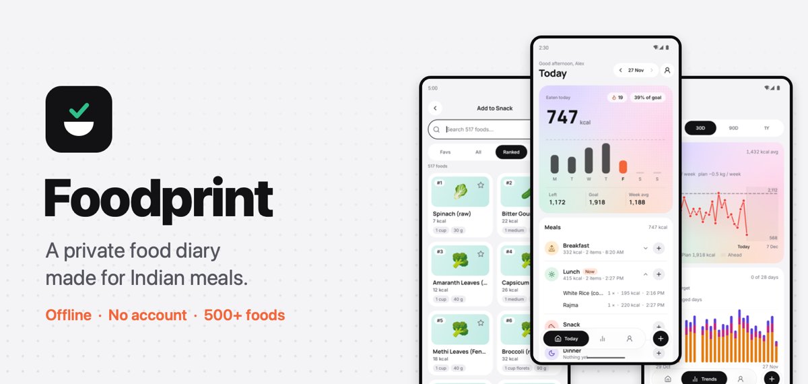
</p>

<h1 align="center">Foodprint</h1>

<p align="center">
  <b>Eat well. See it clearly.</b><br>
  An offline-first Android food diary made for Indian meals.<br>
  500+ dishes with real servings, 30 nutrients, streaks and trends. No account, no ads, no tracking.
</p>

<p align="center">
  <a href="#install">Install</a> ·
  <a href="#features">Features</a> ·
  <a href="#privacy">Privacy</a> ·
  <a href="#build">Build</a> ·
  <a href="docs/ui-house-rules.md">Design system</a>
</p>

<p align="center">
  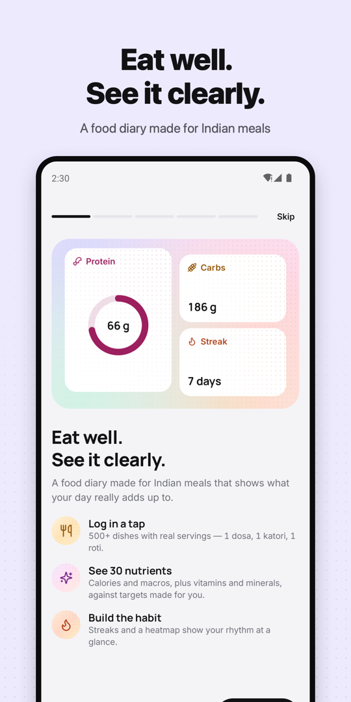
  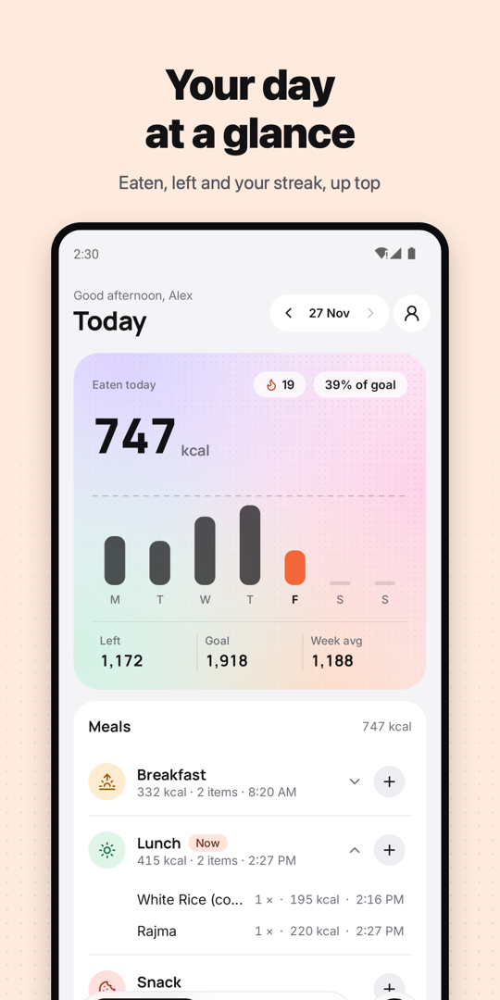
  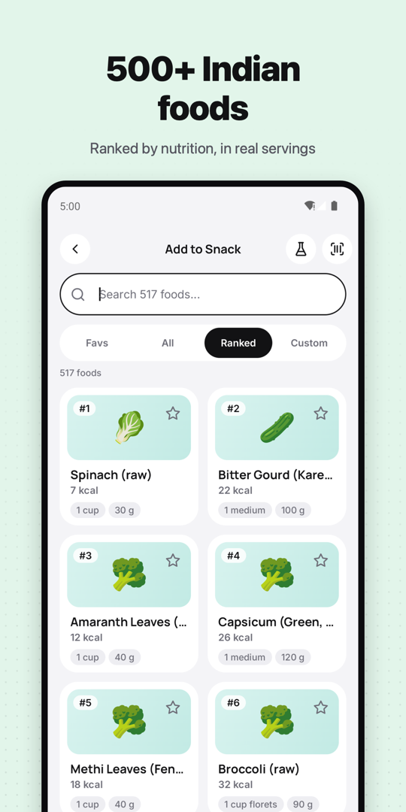
  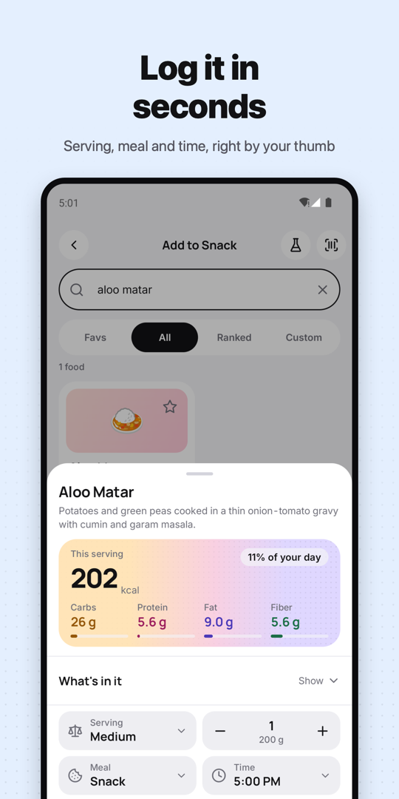
</p>
<p align="center">
  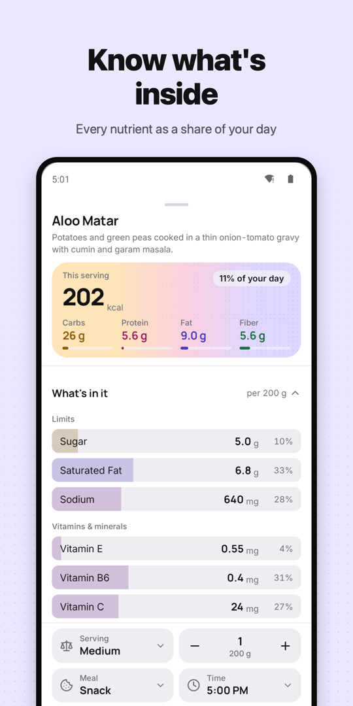
  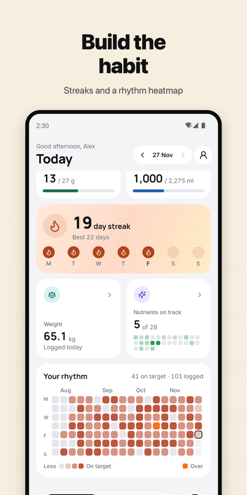
  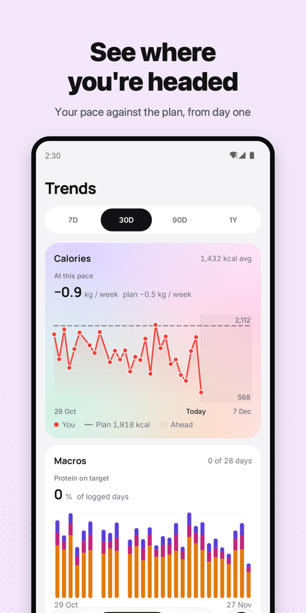
  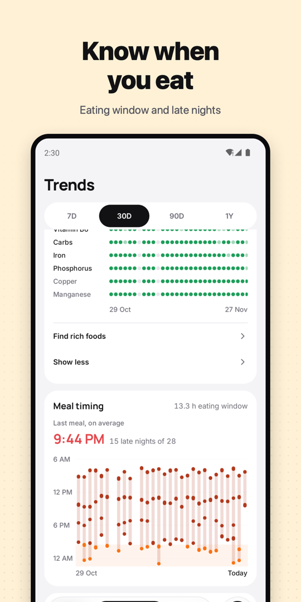
</p>
<p align="center">
  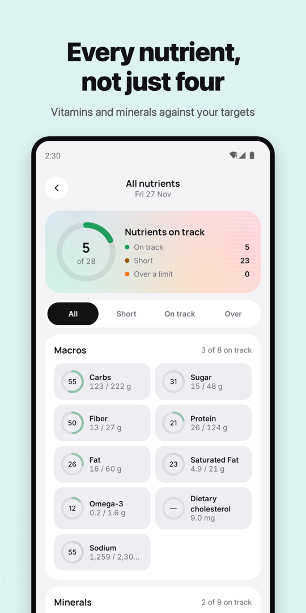
  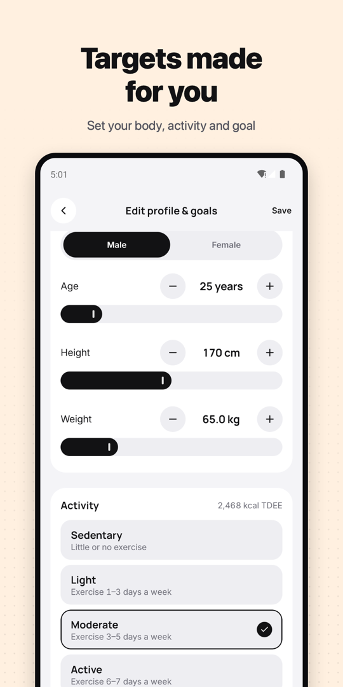
  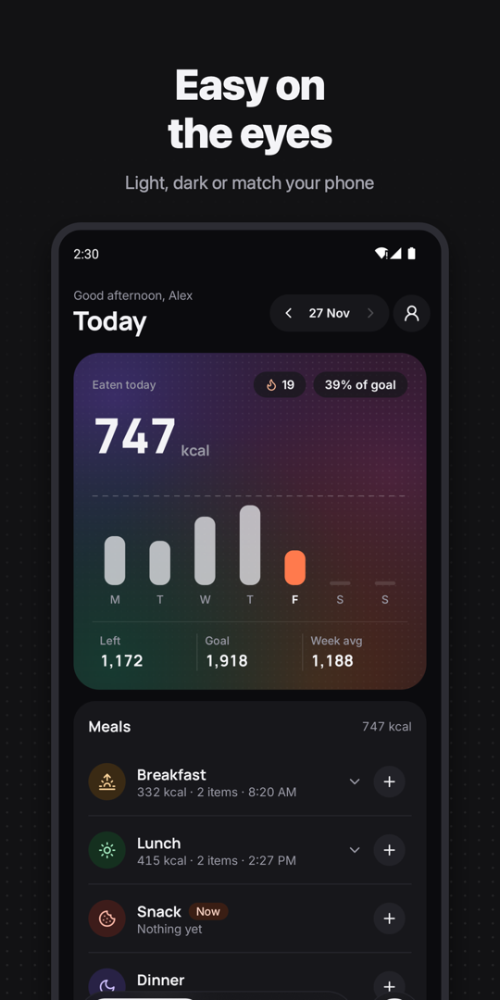
  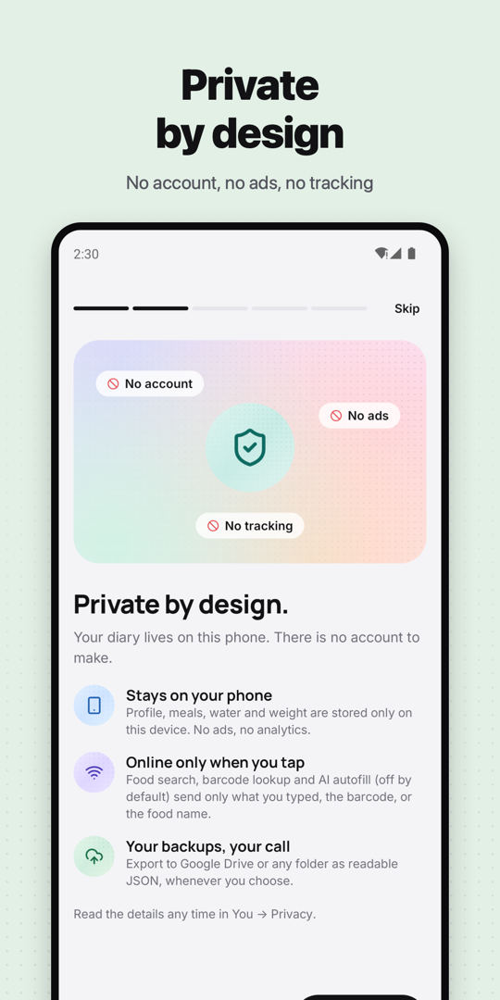
</p>

## Why Foodprint

Most calorie counters are built around barcodes and grams. Indian meals are *1 dosa*,
*1 katori of dal* and *2 rotis*, cooked in whichever oil is in the kitchen. Foodprint starts
there: it ships with the dishes, the servings and the cooking fat, and turns a day of meals
into a clear picture of what it really added up to.

## Features

### Log in a tap
- **517 foods out of the box**, Indian first: dosas, curries, sabzis, sweets, snacks and
  drinks. Each one has a real serving (*1 dosa*, *1 katori*, *1 roti*), and most come with
  a one-line note on how they're made.
- **A 2-column food grid** with Favs, All, Ranked and Custom tabs. It loads 40 foods at a
  time as you scroll and lands on whichever tab you're most likely to want.
- **Ranked by nutrition.** The Ranked tab puts the most nutrition-rich foods first, using
  the NRF9.3 nutrient-density score against your own targets: nine nutrients to get more
  of, minus three to limit, per 100 kcal.
- **Cooking fat is a first-class variable.** Swap groundnut oil for ghee or coconut and the
  dish's fat, saturated fat, vitamin A and cholesterol move with it.
- **When you ate it.** Every entry keeps the time it was eaten (sensible defaults per meal,
  editable), so late dinners show up for what they are.
- **Add anything else** by hand, by **barcode** (on-device scan, then OpenFoodFacts or
  USDA), or with **AI autofill**: your own key for Gemini, Claude or ChatGPT, and only the
  food's name is sent.
- **Back-fill any day** from the date pill, the calendar, a bar in the week chart or a
  square in the heatmap.

### See your day
- **A bento Today screen.** "Eaten today" leads the textured hero, with what's left, your
  goal, the week's bars and your streak. Below it come your meals, then a tile per macro
  and water in its own colour.
- **Streaks and rhythm.** A day streak with your best run, and an 18-week heatmap of how
  close each day came to your calorie goal.
- **30 nutrients, not four:** calories and macros, then fibre, sugar, omega-3,
  cholesterol, nine minerals and thirteen vitamins, each against a target worked out for
  you. Limits (sugar, saturated fat, sodium) are drawn as limits: 40% of a cap is a good
  day, not a shortfall. Dietary cholesterol is tracked without a target, because no
  current guideline sets one (see `NutrientTarget.Untargeted`).
- **Find foods rich in** any nutrient you're short on, ranked across the whole catalogue.

### See where you're headed
- **Plan-based forecasts from day one.** Calories and weight are charted against the plan
  you set in onboarding (lose, hold or gain, at your chosen pace), so Trends is useful
  before you have any history.
- **Meal timing:** your average eating window, when the last meal lands, and how many late
  nights you had.
- **Macro split, nutrient consistency and water** over 7, 30, 90 or 365 days.

### And the rest
- **Targets from your body:** BMR and TDEE from age, sex, height, weight and activity, then
  a calorie goal from your plan. Change any of it and all 30 targets follow.
- **A meal plan** as a shortcut: decide what you'll eat by meal, then log it in a tap.
- **Reminders** for each meal, water and the weigh-in, on Doze-aware alarms.
- **Two home-screen widgets:** calories left, and the macro split.
- **Backup and restore** to Google Drive or any folder, as plain JSON you can read, plus
  automatic snapshots. **Clear diary** or **reset the app** any time.
- **Light, dark or match system**, light by default.

## Privacy

Your diary never leaves the phone. There is no account, no analytics and no ads.

The app goes online from exactly three places, and only when you trigger them: online food
search, barcode lookup, and the optional AI autofill. Backups go only where you send them.
The in-app Privacy screen (You → Privacy) has the details, and your AI key is kept out of
Android's cloud backup.

## Install

Grab the APK from [Releases](../../releases). It is signed with the public key committed in
this repo, so each release installs over the last as an update.

That key is public on purpose, which means anyone can sign an APK with it: it makes updating
easy, but it is never proof of who built a build.

## Build

```sh
./gradlew assembleDebug        # APK at app/build/outputs/apk/debug/
./gradlew installDebug         # build and install on a connected device
./gradlew testDebugUnitTest    # unit tests: streaks, forecasts, meal timing, the food catalogue
./gradlew assembleRelease      # signed, R8-shrunk release APK
```

You need Android SDK 37 and a Java 21 toolchain. The Gradle daemon pins Java 21 in
`gradle/gradle-daemon-jvm.properties` and downloads it if you don't have it, so the wrapper
is all you need. `minSdk` is 31; the app is English only.

CI mirrors this: **Actions → Build Release APK** builds any branch and attaches the APK to
the run, and **Actions → Trigger a Release** bumps the version, builds, then tags and
publishes a release only if the build passed.

### Optional configuration

Both are optional; the app works without either.

**USDA food search.** Falls back to the public `DEMO_KEY`, which works but is rate-limited.
For your own key ([get one here](https://api.data.gov/signup/)), add it to `local.properties`
(git-ignored):

```properties
USDA_API_KEY=your_key_here
```

**AI nutrition autofill.** Off by default and set up in the app, not here: You → AI
autofill, or the last onboarding page.

## Under the hood

Kotlin · Jetpack Compose (Material 3) · Room · DataStore · WorkManager · Glance widgets ·
CameraX + ML Kit barcode scanning · Lucide icons · Haze (frosted bars) · Google Fonts
(Manrope, Inter)

A single module, MVVM:

| Package | What's in it |
| --- | --- |
| `data/` | The Room database, the seeded foods, stores, backup and the API clients |
| `domain/` | Goals (BMR, TDEE, the 30 targets), streaks, plan forecasts, meal timing |
| `ui/` | The design system in `components/` and `theme/`, one package per screen under `screens/` |
| `widget/` | The two home-screen widgets |
| `reminder/` | Alarm scheduling and the notification |

The hand-tuned foods live in `IndianFoodSeed`; the rest of the catalogue, with each food's
"how it's made" line, is data in `app/src/main/assets/food_catalogue.json`. Its numbers
are recipe-based estimates, not lab measurements.

The interface follows a written design system: type roles, colour roles, per-nutrient hues
with a dot texture, standard components, motion and spacing. It is in
[docs/ui-house-rules.md](docs/ui-house-rules.md); read it before changing any screen.

## How it was made

Built with AI assistance (Claude), and directed, designed and tested by its maintainer. The
commit trailers say so too.

## License

[MIT](LICENSE) © 2026 Foodprint contributors.

Nutrient reference values follow ICMR-NIN and the Dietary Guidelines for Americans. Food
data can come from OpenFoodFacts (ODbL) and USDA FoodData Central (public domain). Ships the
AndroidX, Kotlin and ML Kit libraries (Apache 2.0).
